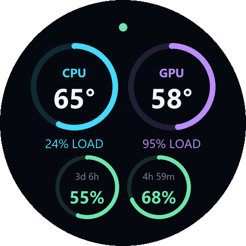

# Nautilus LCD Dashboard

A small Windows utility for a CORSAIR Nautilus LCD cap: CPU/GPU temperatures
and load, Codex / ChatGPT Work quota remaining, and a local Codex activity dot.
Start and stop it with scripts or desktop icons. No browser interface opens.



*An example generated by the actual 480 × 480 renderer, using sample readings:
CPU 65°C / 24% load, GPU 58°C / 95% load, weekly quota 55% remaining, and
five-hour quota 68% remaining. Green indicates an active local Codex session.*

## Features

- Large CPU/GPU temperatures, with usage percentages below the gauges.
- Temperature rings: empty at 20°C, halfway at 60°C, full at 100°C.
- Weekly quota on the left; five-hour quota on the right. Remaining is the default.
- Reset countdown labels show days, hours and minutes, or minutes: `3d`, `4h 59m`, or `27m`. Whole hours show as `5h`; seconds are rounded down.
- Green/gray/amber activity dot for working, idle, or unavailable status.
- Live JSON settings for colors, fonts, ring sizes, brightness, and rotation.
- Start/Stop scripts, desktop icons, and USB reconnect.

## Compatibility

| Requirement | Details |
| --- | --- |
| System | Windows 10/11, 64-bit; tested on Windows 11 |
| LCD | Original round Nautilus RS LCD cap, 480 × 480 |
| USB IDs | `1B1C:0C57` tested; `1B1C:0C55` recognized but not hardware-tested |
| Python | Python 3.12, 64-bit |
| Sensors | .NET Framework 4.7.2 or later, including its C# compiler |
| CPU temperature | Optional signed PawnIO driver and an elevated sensor helper |
| AI quotas | Codex CLI or VS Code Codex extension, signed in with ChatGPT |

Other Corsair LCD families and rectangular Nautilus II screens are not
supported by this transport. Sensor availability depends on your hardware and
[LibreHardwareMonitor](https://github.com/LibreHardwareMonitor/LibreHardwareMonitor).
The tested PC used a Ryzen 7 7800X3D and Radeon RX 9070 XT.

## Download and run

1. Install [Python 3.12 for Windows](https://www.python.org/downloads/windows/),
   choosing the **64-bit** installer and enabling the Python launcher or PATH option.
2. Download the source ZIP from **Releases**, or choose **Code → Download ZIP**.
   Extract it into a writable folder and keep it there; run from the extracted folder.
3. Double-click **Start Dashboard.cmd**. The first run creates a private `.venv`,
   installs Python packages, downloads and verifies LibreHardwareMonitor, compiles
   the sensor bridge, and creates `settings.json` from the example file.
4. If CPU temperature shows a dash, run **Enable CPU Temperature.cmd** once and
   approve the Windows prompt. Then stop and start the dashboard.
5. Run **Create Desktop Shortcuts.cmd** for Start and Stop desktop icons.

Use **Stop Dashboard.cmd** or the Stop icon to stop the app and return the cap
to its saved hardware display. Starting twice keeps one dashboard running.
If you move the folder, recreate its shortcuts.

Start closes iCUE's main app by default to release the LCD. Set
`close_icue_on_start` to `false` if you prefer to quit iCUE yourself. Both apps
should not write to the same screen simultaneously. This utility controls LCD
presentation; it does not configure fans, the pump, or RGB lighting.

After PawnIO is installed, Start may show a Windows permission prompt for the
separate sensor helper. The dashboard runs without administrator rights and
the helper exits when it stops. Driver setup downloads the official installer
and verifies its Windows signature before execution.

### Enable Codex / ChatGPT Work quotas

Install [Codex CLI](https://learn.chatgpt.com/docs/cli) or its IDE extension and
sign in with your ChatGPT account. For the CLI:

```powershell
codex login
```

Restart the dashboard after installing Codex or signing in. It reuses the local
sign-in and makes no model requests. API-key-only authentication does not
provide ChatGPT subscription quotas. These are Codex / ChatGPT Work limits,
not separate limits for ordinary ChatGPT chats.
[Official authentication documentation](https://learn.chatgpt.com/docs/auth).
Hardware readings work without Codex; unavailable quotas display a dash.

## Customize the display

Edit **settings.json** and save. Valid edits apply within about a second;
invalid JSON keeps the previous settings and logs the error. Public defaults
are in [settings.example.json](settings.example.json).

```json
{
  "theme": {
    "bg": "#05090f",
    "ink": "#f3f7ff",
    "cpu": "#45d9ff",
    "gpu": "#ba8cff",
    "ai": "#6de5ad"
  },
  "remaining": true,
  "rotation": 0,
  "brightness": 100,
  "temperature_range": { "min_c": 20, "max_c": 100 },
  "codex_activity": {
    "enabled": true,
    "active_color": "#6de5ad",
    "idle_color": "#344052",
    "unknown_color": "#d6aa66",
    "radius": 8,
    "poll_interval_seconds": 2
  }
}
```

This partial example uses defaults for omitted settings. Rotation accepts 0,
90, 180, or 270 degrees; brightness accepts 33–100. Set `remaining` to `false`
for quota used. The `layout` block controls fonts, ring sizes and thicknesses,
and reset countdown labels. Set `layout.show_reset_times` to `false` to restore
the `WEEK` and `5H` labels. Set `codex_activity.enabled` to `false` to hide
the dot, or `lcd_enabled` to `false` to pause screen output.

Readings outside the temperature range clamp the ring fill; the numeric
temperature stays visible. AI labels gain an asterisk when a connection error
leaves the display showing the last known quota reading.

### Activity dot

The dot reads local turn metadata every two seconds, using cached session-log
reading for older sessions. Live writer locks prevent a crashed host from
remaining green. Idle windows and the quota helper do not count as working;
waiting for approval counts as an active turn.

It monitors `CODEX_HOME`, normally `~/.codex`; cloud sessions and other computers
are not included. Local Codex metadata is version-dependent, so incompatible
or unreadable metadata may display amber instead of a definite status.

## Resource use and privacy

Hardware and LCD frames update about once per second; quotas refresh once per
minute. A 76-second sample on the tested Ryzen PC averaged **0.19% total CPU**
and about **200 MiB of combined working-set memory** across the dashboard and
helpers. Most of that memory belonged to the Codex quota helper. These are
measurements from one setup, not performance guarantees.

Scripts use an internal endpoint bound to `127.0.0.1:8765`, with token-protected
control requests. It serves no web interface or workspace files. Codex credentials
stay in its own storage and are not copied into this folder. This utility adds
no telemetry or model requests. Downloads and quota reads need network access.

Local settings, logs, generated shortcuts, environments, and downloaded
binaries are excluded from Git and source ZIPs.

## Troubleshooting

| Symptom | Check |
| --- | --- |
| LCD unavailable | USB connection, supported ID, and whether iCUE owns it |
| CPU temperature missing | Enable CPU Temperature once, restart, and approve the helper |
| GPU reading missing | GPU/driver support in LibreHardwareMonitor |
| AI quotas missing | Codex installed, ChatGPT sign-in, and network access |
| Amber dot | Unavailable or incompatible local Codex metadata |
| Settings ignored | JSON syntax, supported ranges, and `runtime/dashboard.log` |
| Wrong orientation | Set `rotation` in settings.json |
| Another copy is running | Stop that copy before starting a new extracted version |

## Development and releases

```powershell
py -3.12 -m venv .venv
.venv\Scripts\python.exe -m pip install -r requirements.txt
.venv\Scripts\python.exe -m unittest discover -s tests -v
.venv\Scripts\python.exe tools\check_release.py
.venv\Scripts\python.exe tools\build_release.py
```

The source ZIP and SHA-256 file appear in `dist/`. An explicit file list keeps
generated data and credentials out of releases. `tools/render_example.py`
regenerates the README image with sample readings.

GitHub Actions only packages source releases; tests are optional local checks.
For a public release, update `VERSION` and `CHANGELOG.md`, commit the public files,
then push a matching tag such as `v1.0.0`. The release workflow attaches the source ZIP
and checksum. Manual workflow runs only build artifacts. This source download
requires Python; it is not a standalone EXE.

## License and credits

[MIT](LICENSE). See [third-party notices](THIRD_PARTY_NOTICES.md) for dependency
licenses and protocol credits. CORSAIR and OpenAI do not endorse this project.
